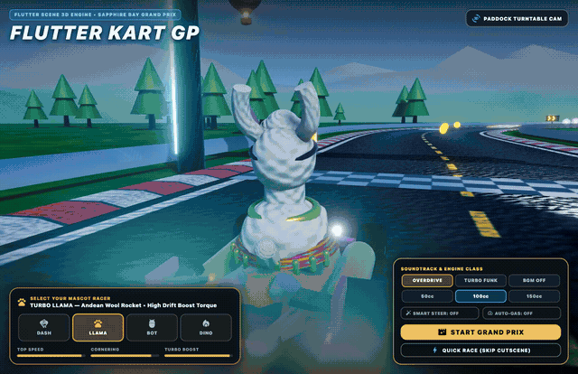

# Flutter Kart Grand Prix 🏎️💨

[-02569B?style=for-the-badge&logo=flutter&logoColor=white)](https://leehack.github.io/flutter-kart-gp/)
[](LICENSE)

A **3D arcade kart racing game** featuring **Flutter Dash** and **Alpaca Llama**, built **100% procedurally in code** using **Flutter GPU** and [`flutter_scene`](https://pub.dev/packages/flutter_scene) — with **zero external 3D models (`.glb`/`.obj`) or image files**.

👉 **[Play Live in Your Browser (WebAssembly / WebGL2)](https://leehack.github.io/flutter-kart-gp/)**



🎬 **[Watch the Full 15-Second Grand Prix Trailer (`flutter_kart_grand_prix_trailer.mp4`)](flutter_kart_grand_prix_trailer.mp4)**

---

## ✨ Highlights

- **100% Procedural 3D Meshes & PBR Materials**:
  - **Sculpted Mascots (`lib/game/kart_builder.dart`)**: Choose between **Flutter Dash** (cyan plumage, aviator goggles, flapping wings, and tuft crest) and **Alpaca Llama** (fluffy wool crown, banana ears, neon star sunglasses, and Peruvian fiesta poncho), each driving a custom twin-exhaust clearcoat Grand Prix kart.
  - **Continuous Spline-Swept Circuit (`lib/game/track_builder.dart`)**: Closed Catmull-Rom/harmonic circuit with procedurally synthesized RGBA normal/albedo asphalt textures, red/white raised curbs, covered stadium grandstands, infield crystal lighthouse lake, hot-air balloons, and an orbiting stadium blimp.
- **Arcade Kart Physics & Assist Systems (`lib/game/kart_physics.dart`)**:
  - **3-Stage Drift Boost**: Hold `Space` / `Shift` while cornering to charge **Blue → Orange → Purple** sparks and release for a turbo surge.
  - **Aero Trick Launch Ramps**: Hit the golden chevron ramps to launch airborne and trigger a **360° Mid-Air Trick** (`Space` / `Drift`) for a landing turbo boost.
  - **Slipstream Drafting, Coins & Items**: Draft behind rivals for a slipstream surge, collect up to 10 Gold Coins (`+10%` top speed), and pick up holographic item boxes (`Turbo Mushroom`, `Triple Mushroom`, `Homing Green Shell`, `Star Invincibility`, `Banana Hazard`).
  - **Speed Classes & Accessibility**: Select **50cc (Breezy)**, **100cc (Arcade)**, or **150cc (Pro)** on the Title Screen, with optional **Smart Steer** and **Auto-Gas** assists plus responsive mobile multi-touch controls.
- **Studio Synth Soundtrack & Stereo SFX (`tool/generate_studio_audio.swift` & `lib/game/sound_manager.dart`)**:
  - Features two multi-track stereo BGM loops (**Cyber Overdrive** @ 132 BPM and **Turbo Funk GP** @ 128 BPM) and 11 stereo arcade sound effects synthesized via macOS `AVAudioEngine` + Roland GS SoundBank (`gs_instruments.dls`), plus a pure-Dart PCM fallback synthesizer and HTML5 Web Audio playback.

---

## 🎮 Controls

| Action | Keyboard | Mobile / Touch |
| :--- | :--- | :--- |
| **Accelerate** | `W` / `↑` *(or Auto-Gas `T`)* | `GAS` Pedal *(or steer stick with Auto-Gas)* |
| **Steer Left / Right** | `A` `D` / `←` `→` | Left Analog Touch Stick |
| **Drift / Aerial Trick** | `Space` / `Shift` | `DRIFT` Button |
| **Use Item** | `E` / `F` / `Enter` | `ITEM` Button |
| **Brake / Reverse** | `S` / `↓` | `BRK` Button |
| **Switch Character** | `Tab` | Character Selector / `CHAR` Chip |
| **Cycle Camera / Look Back** | `C` / Hold `B` | `CAM` / `REAR` Chips |
| **Broadcast Director Cam** | `V` | `TV CAM` Chip |
| **Cycle BGM / Mute Audio** | `L` / `M` | `BGM` / `SFX` Chips |
| **Pause Menu** | `P` / `Esc` | `PAUSE` Chip |

---

## 🚀 Running Locally

### 1. Web (WebAssembly)
```bash
flutter run -d chrome --wasm
```
To build a production WebAssembly bundle:
```bash
flutter build web --wasm
```

### 2. macOS Desktop (Flutter GPU / Metal)
```bash
flutter run -d macos --enable-flutter-gpu
```

### 3. iOS / Android
```bash
flutter run --enable-flutter-gpu
```

---

## 🗂️ Project Structure

- `lib/main.dart` — App entrypoint, keyboard & multi-touch input routing, and `SceneView` loop.
- `lib/game/kart_race_game.dart` — Race state machine (`titleScreen`, `introCutscene`, `racing`, `victoryCutscene`), AI drivers, item projectiles, cameras, and BGM sync.
- `lib/game/kart_physics.dart` — Arcade kart dynamics, 3-stage drift charge, aerial ramp physics, slipstream drafting, and Smart Steer assist.
- `lib/game/kart_builder.dart` — Procedural 3D kart chassis, wheels, plasma afterburners, Flutter Dash, and Alpaca Llama models.
- `lib/game/track_math.dart` — Closed-loop spline math, Frenet-Serret frames, spatial projection, jump ramps, boost pads, coins, and item boxes.
- `lib/game/track_builder.dart` — Procedural 3D road ribbons, swept curbs, stadium grandstands, infield lake, sky landmarks, and runtime RGBA PBR texture synthesis.
- `lib/game/sound_manager.dart` & `lib/game/sound_backend_*.dart` — Cross-platform BGM & SFX engine (Web HTML5 Audio, macOS/mobile native playback, and pure-Dart stereo PCM fallback synthesizer).
- `lib/ui/race_hud.dart` — Broadcast-style Title Screen, Intro/Victory cinematic overlays, speedometer, minimap, and mobile touch controls.
- `tool/generate_studio_audio.swift` — Offline 44.1 kHz stereo synthesizer using `AVAudioEngine`, `AVAudioUnitSampler` (Roland GS SoundBank), and `AVAudioUnitReverb`.

---

## 📄 License

Released under the [MIT License](LICENSE).
